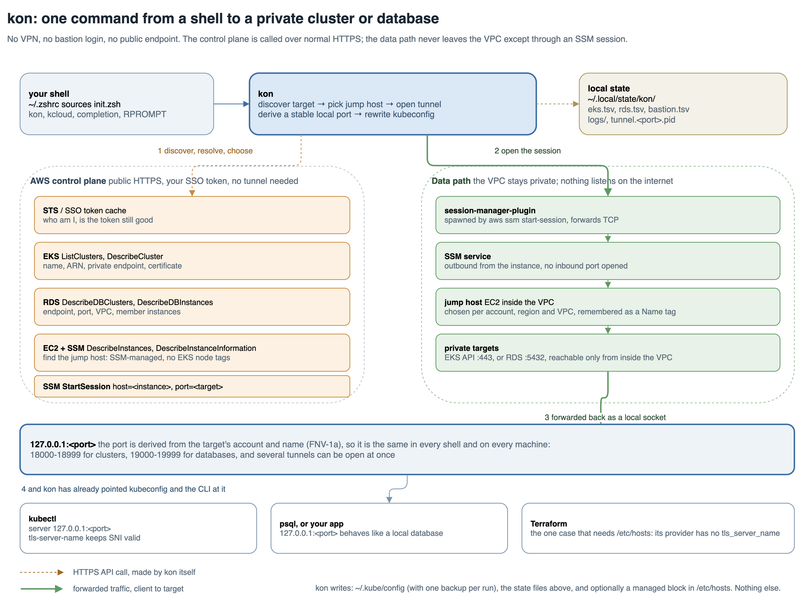

# kon

One command to reach **any** private EKS cluster or RDS database your AWS
profiles can see.

```bash
kon                     # pick a cluster (fzf), or:
kon demo-dev            # match by name
k get po                # just works

kon rds                 # pick an account, then a database
psql -h 127.0.0.1 -p 19264 ...
```

The target type is an optional first word and defaults to `eks`, so every
command below also has an explicit `kon eks ...` form. `eks` and `rds` are
reserved names.

`kon` resolves the whole chain for you: cluster, AWS profile, SSO session, kube
context, bastion, SSM tunnel, kubeconfig, health check. Nothing needs keeping in
sync by hand. Several clusters can be connected **at the same time**, each on its
own stable port.

It replaces this:

```bash
aws sso login --sso-session <session>     # was the session even expired?
export AWS_PROFILE=<profile>              # which profile goes with this cluster?
kubectx <cluster>                         # hope it matches the profile
```

---

## Architecture



Two planes, and only one of them is your business to secure: `kon` calls the AWS
control plane over ordinary HTTPS with your SSO token, then opens a single SSM
session through a jump host so the data path never leaves the VPC. Nothing
listens on the internet, and no inbound port is opened on the bastion.

The picture in words, left to right:

1. Your `.zshrc` sources `init.zsh`, which loads `kon.zsh`, the prompt segment
   and the completion. No daemon, no wrapper binary, nothing running in the
   background except the tunnels you asked for.
2. `kon` calls STS, EKS, RDS, EC2 and SSM to work out what exists, which profile
   and region to use, and which instance is the jump host. It caches what it
   learns under `~/.local/state/kon/` so the next call is instant.
3. It starts `aws ssm start-session`, which hands off to
   `session-manager-plugin`. The instance dials out to SSM, so the session works
   from inside the VPC without an inbound rule.
4. The jump host connects to the private target: the EKS API on 443, or the
   database on its port.
5. The far end of that session is a loopback socket on a port derived from the
   target's account and name, so kubectl, psql and Terraform just talk to
   `127.0.0.1:<port>`.

Editable source: [`docs/kon-architecture.drawio`](docs/kon-architecture.drawio).

## How it works

Private EKS clusters have no public API endpoint, so `kubectl` cannot reach them
directly. `kon` forwards the API through an SSM-managed bastion inside the VPC:

```
kubectl ──► https://127.0.0.1:<derived port>
                 │   (+ tls-server-name = the real EKS hostname,
                 │      so the certificate still validates)
                 ▼
        local SSM port-forward
                 │
                 ▼
        bastion (EC2, via SSM)  ──►  <eks-host>:443   (private, inside the VPC)
```

The kubeconfig entry ends up as:

```yaml
- cluster:
    server: https://127.0.0.1:18639
    tls-server-name: AAAA1111.gr7.eu-west-1.eks.amazonaws.com
```

**Why `tls-server-name` instead of an `/etc/hosts` entry.** The older approach
pointed the real hostname at `127.0.0.1` in `/etc/hosts` and kept the port in the
kubeconfig URL. That needs `sudo`. Worse, every cluster then resolves to the same
loopback address, which forces a single shared port, so only one tunnel can be
alive at a time. Setting `tls-server-name` moves the hostname out of DNS and into
TLS/SNI: the certificate still validates, no `sudo` is needed, and each cluster
owns its own port.

`/etc/hosts` is still required for **Terraform**, whose Kubernetes provider has
no `tls_server_name` equivalent. `kon` therefore offers to add the entry (y/N)
and only exports `TF_VAR_kubernetes_host_override` once it exists.

---

## Ports are derived, not allocated

A target's local port is a pure function of its identity:

```
cluster  port = KON_PORT_BASE     + FNV1a("<account-id>/<cluster-name>") % KON_PORT_SPAN
database port = KON_RDS_PORT_BASE + FNV1a("<account-id>/<db-name>")      % KON_RDS_PORT_SPAN
```

Clusters land in `18000-18999` and databases in `19000-19999`, so the port alone
tells you what you are talking to, and a cluster and a database can never hash
into the same slot. The account id is part of the identity, so two databases that
share a name in different accounts still get different ports. This is deliberately not a "first free port" scan:

| Property | Why it matters |
| --- | --- |
| **stable** | Same port in every shell, forever, whatever order you connect in. A long Terraform run's host override cannot shift under it. |
| **race-free** | Two terminals connecting different clusters derive different ports, so there is no allocate-then-bind window to collide in. |
| **explainable** | "Which port is this cluster on?" has one answer, computable offline. The kubeconfig merely caches it. |
| **insulated** | The range sits above the usual dev-server ports (8000-8099) and below the macOS ephemeral range (49152+), so the slot is essentially never taken. |

If something foreign *is* holding the canonical port, `kon` probes `+1`, `+2` and
so on deterministically, and warns. A tunnel that is already **live** on a
non-canonical port is never torn down just to migrate it. `--status` marks it `~`,
and it adopts the canonical port on the next reconnect.

---

## Where the target list comes from

Both sides work the same way. `--discover` asks AWS once and caches the answer,
and everything else reads the cache, so picking, `--status` and `--stop` make no
AWS call at all. Re-run `--discover` when targets are created or destroyed.

**`--discover` is read-only.** For clusters it writes only `KON_EKS_CACHE`. It
does *not* run `aws eks update-kubeconfig`. A cluster is added to the kubeconfig
the first time you actually connect to it, so that file stays as small as your
real usage instead of accumulating every cluster in every account. In
`kon eks --status`, `+` marks a cluster kon knows about that kubectl does not
yet.

Registration is deferred rather than removed because `kubectl` genuinely needs
its kubeconfig entry: the cluster CA and the `exec` credential plugin live there.
`psql` needs no such file, which is the only reason the database side never
touches one.

`kon eks --prune` removes kubeconfig entries whose cluster no longer appears in
the cache, plus extra contexts for a cluster another context already covers. Only
`arn:aws:eks:` entries are ever candidates, so a local context like
`rancher-desktop` is safe, and it asks before removing anything.

For databases, `--discover` records `describe-db-clusters` plus
`describe-db-instances`, skipping instances that are merely members of a cluster
already listed. That list can get long, so `kon rds` with nothing to go on asks
for the **account first**, then the database within it. A name, or `-p PROFILE`,
skips straight past that.

---

## Which instance it jumps through

A port-forward needs an instance **registered with SSM**. That, not its name, is
the real requirement. But SSM registration alone is a poor filter, because EKS
worker nodes are SSM-managed too, so "everything SSM-managed" returns the whole
node group. `kon` asks in this order:

1. `--bastion i-0abc...`, an explicit instance id, wins outright
2. `--bastion NAME`, resolved to a running instance with that `Name` tag
3. whatever `KON_JUMP_CACHE` remembers for this account, region and VPC
4. discovery: running, SSM-managed, and **not** tagged as a Kubernetes node

Step 4 is the interesting one. Worker nodes are SSM-managed too, so SSM
registration alone is useless as a filter: it returns 7 instances in one account
here. Excluding anything tagged `eks:cluster-name`, `aws:eks:cluster-name` or
`kubernetes.io/cluster/*` leaves **exactly one** instance in all seven accounts
tested, and in every case it is the bastion. A jump host is identified by what it
is not.

When several candidates survive they are narrowed by the target's VPC, then
ranked by `KON_JUMP_WORDS` in order, then by the cluster or database stem. A tier
that would leave **nothing** is skipped, so a hint can narrow but never eliminate
the right answer. Genuine ambiguity is asked once and remembered, so it is never
asked again.

The VPC costs no extra API call. A cluster's comes from the `describe-cluster`
that already resolves its endpoint, and a database's is recorded at discovery from
the `describe-db-instances` that already runs: an Aurora cluster reports only a
subnet group *name*, but its member instances report the VPC id directly. An
account with two VPCs therefore keeps one jump host per VPC.

A name is never *derived and looked up*. Measured across ten accounts,
`<cluster-stem>-bastion` was correct only **4 times in 7**, for two independent
reasons. A cluster can carry a prefix its bastion does not, so `ex-app-dev-main`
sits next to `app-dev-bastion`. And the `-main` suffix is not universal, so
stripping it leaves a component the bastion never had: `app-dev-featurename` sits
next to `app-dev-bastion`.

The cache stores the **`Name` tag, not the instance id**, because an ASG
replacement or AMI refresh changes the id and leaves the tag alone. Nothing needs
invalidating when an instance is replaced.

A row written before the VPC column existed is read as VPC-agnostic rather than
mistaking the name for a VPC id, and it rewrites itself with the real VPC the
first time it is used.

Matching happens **in the client, never in the AWS filter**, because EC2 tag
filters are case-sensitive: `Values=*bastion*` does not match `Bastion-01`. So
`bastion`, `Bastion` and `BASTION` all match, and a test asserts the candidate
query carries no `tag:Name` filter at all.

One candidate is used silently. Several are offered as a picker. **With no
terminal** (a script, CI) a picker would block forever, so `kon` prints the
candidates and fails, naming `kon bastion` as the fix.

---

## SSO, without a browser every hour

An SSO **access token** always lives exactly 60 minutes. That is fixed by AWS,
not something Identity Center admins can raise; what they configure is the
*session duration*, which bounds how long the refresh token may keep minting new
access tokens. botocore performs that refresh silently on the next API call.

So an expired access token is **not** a reason to run `aws sso login`. Doing that
would drag you through the browser every single hour. `kon` prefers, in order:

1. cached token still valid, so nothing to do and zero network
2. refresh token usable, so one cheap `sts get-caller-identity` triggers the refresh
3. otherwise, interactive login

The refresh is **lazy, never scheduled**. There is no timer and no background
process. An expired token just sits there until the next AWS call needs it, which
is why an idle laptop costs nothing. `kon` reporting

```
>> SSO     : token good for 11m (refreshes silently when next used)
```

does not mean anything will happen in 11 minutes. It means that when the token
does lapse, the next `kon` or `kubectl` renews it without a browser.

A tunnel already running is unaffected regardless: the SSM session is
authenticated when it is established. What needs live credentials is
`aws eks get-token` for `kubectl`, and that refreshes on demand like anything
else, so expiry never breaks an open tunnel.

---

## Install

Requirements: `zsh`, `awscli` v2, `session-manager-plugin`, `kubectl`,
`python3`, `lsof`. `fzf` is optional but makes `kon` with no argument
interactive.

### Homebrew

```bash
brew install tibatko509/tap/kon
```

Then run the installer it ships once, which writes the `~/.zshrc` block in the
right place:

```bash
"$(brew --prefix)/opt/kon/share/kon/scripts/install.zsh"
exec zsh
```

Use the `opt` path, not a `Cellar` one: `brew cleanup` deletes the versioned
directory at the next upgrade, and `opt` follows it.

The formula declares `fzf`. The three things Homebrew cannot express as
dependencies are in its caveats, because `session-manager-plugin` is a cask and
`awscli`/`kubernetes-cli` are only needed for some workflows:

```bash
brew install awscli
brew install --cask session-manager-plugin
brew install kubernetes-cli
```

Upgrade with `brew upgrade kon`, then `exec zsh`.

### Debian and Ubuntu

```bash
sudo apt install ./kon_<version>_all.deb
"$(dirname "$(dpkg -L kon | grep init.zsh)")/scripts/install.zsh"
```

The `.deb` installs the sources under `/usr/share/kon` and declares `zsh` and
`python3`, with `lsof` and `fzf` recommended. Every release attaches it, and
`kon --update` prints the apt command rather than pulling a git checkout it does
not have.

### From a git checkout

```bash
brew install awscli kubectl kubectx fzf
brew install --cask session-manager-plugin
```

Then:

```bash
git clone https://github.com/tibatko509/kon ~/kon
~/kon/scripts/install.zsh
exec zsh
```

Clone it wherever you like. `init.zsh` locates its own directory, so nothing
depends on that path. `~/kon` is just the example used below.

The installer adds one managed block to `~/.zshrc` (after `compinit`, so
completion registers), backs the file up first, and is idempotent. Use
`--dry-run` to see the diff without touching anything.

Prefer to wire it yourself? It is one line:

```zsh
source ~/kon/init.zsh
```

### What it writes, and what it needs

A flat inventory, so none of it is a surprise:

| Path | Written when | Mode |
| --- | --- | --- |
| `~/.kube/config` (or `$KUBECONFIG`) | a cluster is registered, or its endpoint rewritten to the tunnel | kon does not change it |
| `~/.kube/config.bak.<timestamp>` | once per run, before that run's first write | copied from the file it backs up |
| `~/.local/state/kon/{eks,rds,bastion}.tsv` | `--discover`, and a remembered jump host | your umask, `0644` normally |
| `~/.local/state/kon/logs/<tag>-tunnel.<port>.log` | every tunnel attempt | directory `0700`, file `0600` |
| `~/.local/state/kon/tunnel.<port>.pid` | while a tunnel is up | your umask, `0644` normally |
| `/etc/hosts` | only if you answer `y`, and only for Terraform | managed block, mode unchanged, plus `/etc/hosts.bak.<timestamp>` |
| the `~/.zshrc` block | `scripts/install.zsh` | unchanged, plus `~/.zshrc.bak.<timestamp>` |

The caches are rewritten through a `.tmp` sibling and renamed.
`~/.config/kon/config.zsh` is read when it exists and never written.

**AWS permissions.** kon only reads. No cluster, database, instance, security
group or SSM document is created, modified or deleted, and `--discover`,
`--status`, `--prune` and a connect make only read calls. A read-mostly policy
is enough:

```json
{
  "Version": "2012-10-17",
  "Statement": [
    {
      "Effect": "Allow",
      "Action": [
        "eks:ListClusters",
        "eks:DescribeCluster",
        "rds:DescribeDBClusters",
        "rds:DescribeDBInstances",
        "ec2:DescribeInstances",
        "ssm:DescribeInstanceInformation",
        "ssm:StartSession",
        "sts:GetCallerIdentity"
      ],
      "Resource": "*"
    }
  ]
}
```

`aws eks update-kubeconfig`, which registers a cluster, only reads.
`ssm:StartSession` has to be allowed for the instances and for the
`AWS-StartPortForwardingSessionToRemoteHost` document. `--stop` kills the local
forwarder, so `ssm:TerminateSession` is not needed.

**Uninstall.**

- `git clone`: delete the managed block from `~/.zshrc`, then delete the clone
  and `~/.local/state/kon`.
- `.deb`: `sudo apt remove kon`, which removes `/usr/share/kon`. The package
  writes nothing outside that directory, but the block in `~/.zshrc` is not its
  to remove and stays behind. It is written guarded,
  `if [[ -r <path>/init.zsh ]]; then source <path>/init.zsh; fi`, so a leftover
  block is inert once the files are gone. Delete it when you want it gone.

**Why `~/.kube/config` and `/etc/hosts` at all.** A private cluster has no
endpoint `kubectl` can reach, so kubectl is pointed at `127.0.0.1:<port>` and
told the real hostname through `tls-server-name`. That is a write to the file
kubectl itself reads, backed up once per run. Terraform's Kubernetes provider
has no `tls_server_name` equivalent and needs the hostname in `/etc/hosts`
instead, which is why that one asks first and is never added without a `y`.

### First run

Run `kon doctor` once, before the first connect. It checks the shell
integration, `aws` (v2), `session-manager-plugin`, `kubectl`, `python3`, `lsof`,
`zsh/net/tcp`, the AWS config and the caches, states what it found, and prints
the install command for whatever is missing. It makes no AWS call. Exit status
is 0 when every required piece is present.

### Finding your targets

```bash
kon --discover      # cache every cluster across every SSO profile (read-only)
kon rds --discover  # same for databases
```

Neither writes to the kubeconfig. `kon` matches against the cache as well as the
kubeconfig, so a discovered cluster is connectable immediately, and the kubeconfig
entry is written on that first connect. Re-run `--discover` when clusters or
databases are created or destroyed.

You can still register a cluster by hand if you prefer:

```bash
aws eks update-kubeconfig --name <cluster> --region <region> \
    --profile <profile> --alias <cluster>
```

That bakes `AWS_PROFILE` into the kubeconfig user entry, which is one of the two
ways `kon` maps a cluster to a profile. The other is matching the ARN's account id
against `sso_account_id`.

---

## Updating

How kon updates depends on how it was installed, and `kon --update` detects which
one it is running from instead of guessing:

| Installed by | Update with |
| --- | --- |
| `git clone` (`.zshrc` sources `init.zsh` out of the working tree) | `kon --update`, which is a `git pull --ff-only` |
| the `.deb` | `sudo apt install --only-upgrade kon` |
| Homebrew | `brew upgrade kon` |

From a package, `kon --update` prints the command and exits non-zero rather than
running git, because a Cellar or `/usr/share/kon` copy is not a checkout of
anything it should touch.

The clone **is** the installation for the git channel: there is nothing to copy,
build or reinstall:

```bash
kon --update      # or: git -C ~/kon pull --ff-only
exec zsh
```

`exec zsh` is not optional, and it is the easy trap here: shell functions are
read into memory at startup, so a pull on its own changes nothing in the session
you are sitting in. `kon --update` says so rather than letting you assume
otherwise, and offers to reload for you.

**Running tunnels survive the reload.** `exec` replaces the process image but
keeps the same PID, so the `session-manager-plugin` children are neither killed
nor reparented. Confirm with `kon --status` afterwards.

`--ff-only` is deliberate: if the checkout has local edits or has diverged, the
update fails loudly instead of inventing a merge commit. `kon --update` refuses
outright on a dirty tree and shows you what is modified.

---

## Commands

| Command | What it does |
| --- | --- |
| `kon` | Pick a cluster interactively (fzf), then connect. |
| `kon <cluster>` | Connect by name: exact match, else unique prefix, else unique substring. |
| `kon --status` | Every known cluster, its derived port, and whether the tunnel is up. |
| `kon --stop [cluster]` | Tear down one tunnel, or all of them. |
| `kon --discover [profile]` | Cache every reachable cluster. Read-only: writes no kubeconfig entry. |
| `kon --prune` | Drop kubeconfig entries for clusters that no longer exist, after confirming. |
| `kon bastion [profile]` | Choose the instance to tunnel through for an account. |
| `kon bastion --status` | Which jump host each account and region uses. |
| `kon bastion --forget [account]` | Drop a remembered choice, or all of them. |
| `kon doctor` | Check every required piece and the caches without an AWS call, and name what is missing. |
| `kon --update` | Update the way it was installed: `git pull` from a clone, or the apt/brew command from a package. Says whether a reload is needed. |
| `kon --version` | Released version, annotated with `git describe` in a checkout. |
| `kon --help` | Full flag list. |

Databases are the same shape, behind the `rds` noun:

| Command | What it does |
| --- | --- |
| `kon rds` | Pick the account, then the database, then connect. |
| `kon rds <name>` | Connect by name: exact, else prefix, else substring. |
| `kon rds --status` | Every cached database, its derived port, tunnel state. |
| `kon rds --stop [name]` | Tear down one database tunnel, or all of them. |
| `kon rds --discover [profile]` | Ask AWS what databases exist and cache the answer. |

With no noun, `kon --status` and `kon --stop` cover **both** kinds at once, which
is usually the question you actually have. `kon --discover` still means clusters:
each side discovers into its own store, so there is no combined form.

Flags: `-l/--local-port PORT` (override the derived port once),
`-t/--timeout SECONDS` (readiness timeout), `-b/--bastion NAME|i-ID` (pin the
instance to jump through), `-p/--profile PROFILE` (scope `rds` to one account).

---

## Configuration

There is no site-specific value committed in this repo. The SSO session is
**discovered** from `~/.aws/config` (which already defines it), and everything
else is a naming convention with a default.

Precedence: an environment variable wins over `~/.config/kon/config.zsh`, which
wins over the default.

| Variable | Default | Meaning |
| --- | --- | --- |
| `KON_SSO_SESSION` | auto-discovered | Which `[sso-session]` to use. Only needed if `~/.aws/config` defines more than one. |
| `KON_CLUSTER_SUFFIX` | `-main` | Stripped from the cluster name to get the `<app>-<env>` stem. |
| `KON_JUMP_WORDS` | `(bastion jump jumpbox jumphost)` | Ordered vocabulary used to rank jump host candidates. Matched case insensitively, anywhere in the `Name` tag. Order is priority. Never used to look a name up. |
| `KON_PORT_BASE` | `18000` | First port of the derived cluster range. |
| `KON_PORT_SPAN` | `1000` | Size of that range. |
| `KON_RDS_PORT_BASE` | `19000` | First port of the derived database range. |
| `KON_RDS_PORT_SPAN` | `1000` | Size of that range. |
| `KON_AWS_CONFIG` | `$AWS_CONFIG_FILE` or `~/.aws/config` | AWS config file. |
| `KON_SSO_CACHE` | `~/.aws/sso/cache` | SSO token cache. |
| `KON_EKS_CACHE` | `~/.local/state/kon/eks.tsv` | Where `kon eks --discover` records the clusters it found. |
| `KON_JUMP_CACHE` | `~/.local/state/kon/bastion.tsv` | Which jump host each account, region and VPC uses. Stores the `Name` tag, not an instance id. |
| `KON_RDS_CACHE` | `~/.local/state/kon/rds.tsv` | Where `kon rds --discover` records what it found. Deliberately not `$XDG_STATE_HOME`, which some GUI apps export for the shells they spawn. The path must not depend on what launched your terminal. |
| `KON_PYTHON` | first `python3` on `PATH` | Interpreter for the parsing helpers. Set it when python3 lives outside `PATH`. |
| `KON_CONFIG` | `~/.config/kon/config.zsh` | Optional overrides file. |
| `KON_NO_PROMPT` | unset | Set to `1` to skip the right-prompt cloud indicator. |

So if your clusters are named `foo-prod` rather than `foo-prod-main`:

```zsh
# ~/.config/kon/config.zsh
: "${KON_CLUSTER_SUFFIX:=}"
```

Use `: "${VAR:=v}"` in that file so an environment variable still wins; use a
plain `VAR=v` only when you mean to force the value.

---

## The prompt indicator

`prompt.zsh` adds a cloud segment to `RPROMPT` (`aws:eu-west-1`). It reads the
cluster **ARN**, not the context name. Context names are usually short aliases,
so testing the context against `arn:aws:eks:*` never matches and you get a bare
`k8s`.

It costs two `kubectl` spawns, so it is not called from the prompt. A `precmd`
hook recomputes it only when the kubeconfig's mtime changes (via the `zsh/stat`
builtin, zero forks in steady state), and `kon` seeds the value directly, so even
the post-switch recompute is usually free.

Set `KON_NO_PROMPT=1` before sourcing `init.zsh` to skip it.

---

## Tests

```bash
./test/run.zsh
```

293 assertions, and they need **no AWS credentials, no kubectl and no cluster**.
The kubeconfig and AWS-config parsers are fed fixtures, `kubectl` and `aws` are
stubbed on `PATH`, and `$HOME` is redirected for the SSO cases.

The suite deliberately never redeems the real refresh token. Those **rotate on
use**, so a test that used it would invalidate your live session as a side
effect.

Three cases exist because the bug they describe actually happened, silently:

- **`print -r` emits a literal `\t`.** `-r` suppresses escape expansion, so a row
  built with `"a\tb"` is one unsplittable field. The whole row landed in `$ctx`
  and the caller went looking for a bastion literally named `-bastion`.
- **A tunnel identified by argv coincidence.** The first liveness check walked to
  the listener's *parent* and grepped its full command line, so any process whose
  argv merely mentioned the EKS hostname looked like a working tunnel. A squatted
  port passed for a healthy one.
- **Port determinism.** Pinned hash vectors, so a change to the hash function is
  caught here instead of silently moving every port on upgrade.

CI runs the suite plus `zsh -n` on Ubuntu (not macOS: private repos bill macOS
runners at a 10x minute multiplier, and nothing under test is macOS-specific).

---

## Contributing to this repo

`main` is guarded by a versioned `pre-push` hook. Hooks are per-clone and are
never cloned with the repo, so enable it once:

```bash
git config core.hooksPath .githooks
```

Then the normal route is a branch and a PR:

```bash
git switch -c my-change
git push -u origin my-change
gh pr create --fill && gh pr merge --merge
```

Use `--merge`, not `--squash`. Squashing rewrites the commits, which drops their
GPG signatures and lands an unsigned commit on `main`. A merge keeps every signed
commit intact, and GitHub signs the merge commit itself.

Why a hook rather than a branch protection rule: GitHub gates protection and
rulesets behind **GitHub Pro for private repositories**, and the API says so
outright, `Upgrade to GitHub Pro or make this repository public to enable this
feature`. The hook has one genuine advantage over the server-side rule anyway.
It does not apply to CI, so the release job still pushes its `chore(release)`
commit to `main` without needing a bypass grant.

It is a guardrail, not a security control, and `--no-verify` walks past it. To
override deliberately, prefer the narrower switch, which disables only this check
instead of every hook:

```bash
KON_ALLOW_MAIN_PUSH=1 git push origin main
```

---

## Releases

Versioning is automated with [semantic-release](https://semantic-release.gitbook.io/):
on every push to `main` that passes CI, the Conventional Commit subjects since
the last tag decide the next version.

| Commit prefix | Effect |
| --- | --- |
| `fix:` | patch, `1.2.3` to `1.2.4` |
| `feat:` | minor, `1.2.3` to `1.3.0` |
| `feat!:` or a `BREAKING CHANGE:` footer | major, `1.2.3` to `2.0.0` |
| `docs:`, `test:`, `ci:`, `chore:`, `refactor:`, `style:` | no release |

A release writes `VERSION`, prepends the notes to `CHANGELOG.md`, commits both
with `[skip ci]` (so the workflow cannot retrigger itself), tags `vX.Y.Z` and
publishes a GitHub Release.

**Nothing is published to a package registry.** `package.json` exists only to
pin the release toolchain, is marked `private`, and `@semantic-release/npm` is
deliberately absent from the plugin list. The test suite asserts that.

Two consequences worth knowing:

- The release commit is made by CI, so it is signed with a **separate bot GPG
  key** whose private half lives only in the `BOT_GPG_PRIVATE_KEY` repo secret.
  The committer is forced to `<user>@users.noreply.github.com`, because
  semantic-release otherwise defaults to an address GitHub cannot verify.
- `kon --version` reads `VERSION`, so a tarball reports the released number. In a
  git checkout it appends `git describe`, because a checkout can sit several
  commits ahead of the last release, and quoting a stale number at someone who is
  debugging is worse than saying nothing.

```console
$ kon --version
kon 1.0.0
$ kon --version          # three commits past the tag
kon 1.0.0 (git: v1.0.0-3-gab12cd4)
```

Try a release without performing one:

```bash
GITHUB_TOKEN=$(gh auth token) npm run release:dry
```

---

## Troubleshooting

| Symptom | Cause | Fix |
| --- | --- | --- |
| `connection refused 127.0.0.1:<port>` | No tunnel | `kon <cluster>` |
| Bastion not found / not running | Wrong profile or region, or the bastion is stopped | Check `kon --status`; start the bastion |
| `x509` / certificate errors | `tls-server-name` missing from the kubeconfig | Reconnect with `kon`, which rewrites it |
| Terraform cannot reach the cluster | No `/etc/hosts` entry | Reconnect and answer `y` |
| `several sso-sessions ... set KON_SSO_SESSION` | More than one `[sso-session]` in `~/.aws/config` | Export `KON_SSO_SESSION=<name>` |
| Browser opens every hour | Refresh token missing or registration expired | Run `aws sso login` once to re-register |
| Port fell back to `+1`/`+2` | Something foreign holds the canonical port | `lsof -nP -iTCP:<port> -sTCP:LISTEN` |
| `No database cached` | Nothing discovered yet, or the cache moved | `kon rds --discover` |
| A database is missing from `kon rds` | Created after the last discovery | `kon rds --discover` |
| `is not this database's tunnel` | Something local (often your own postgres) holds that port | Stop it, or pass `-l PORT` |
| `Several candidates ... pin one with --bastion` | More than one instance matched and there is no terminal for a picker | `--bastion <name\|i-id>` |

A tunnel does **not** auto-reconnect if the SSM session drops. Rerun `kon`; it
no-ops when the tunnel is already healthy. Start-up logs for a failed attempt
land in `~/.local/state/kon/logs/`, named `<tag>-tunnel.<port>.log`, where the
tag is `kon` for a cluster and `kon-rds` for a database.

A listener on the expected port is never taken as proof of a tunnel: it must be
the forwarder process `kon` started, whose PID it records under
`~/.local/state/kon/`. A tunnel started by an older version is still recognised
through its `ssm start-session` parent. This matters most for databases, where a
local postgres on the port would otherwise be silently accepted and `psql` would
reach the wrong database while reporting success.
